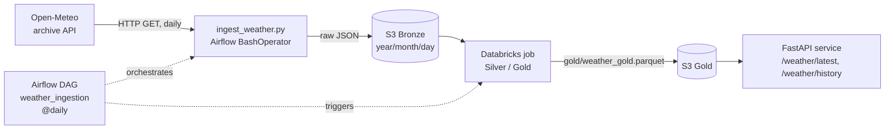

# Weather MLOps Pipeline

A batch data pipeline that pulls daily weather data from the Open-Meteo archive API, lands it unchanged in S3 (Bronze layer), and triggers a Databricks job that builds the Silver/Gold layers. Airflow orchestrates the daily run, and a small FastAPI service serves the Gold data over HTTP.

## Architecture



1. **Ingestion** ([ingestion/ingest_weather.py](ingestion/ingest_weather.py)): requests one day of hourly data (`temperature_2m`, `relative_humidity_2m`, `precipitation`, `wind_speed_10m`, `surface_pressure`) for the configured coordinates. Defaults to yesterday, because the archive API lags by about a day.
2. **Bronze (S3)**: the API response is stored as-is, one JSON object per day:
   `bronze/weather/year=YYYY/month=MM/day=DD/weather_YYYY-MM-DD.json`
3. **Orchestration** ([airflow/dags/weather_ingestion_dag.py](airflow/dags/weather_ingestion_dag.py)): DAG `weather_ingestion`, scheduled `@daily`, two tasks in sequence: `ingest_weather_data` (runs `python -m ingestion.ingest_weather`) then `process_silver_gold` (`DatabricksRunNowOperator`, connection `databricks_default`). One retry with a 5-minute delay.
4. **Silver/Gold (Databricks)**: a Databricks job, started by the DAG, reads Bronze and produces the curated layers. The job's code lives in the Databricks workspace and is **not** part of this repository.
5. **API** ([api/main.py](api/main.py)): a FastAPI service that reads the Gold table from S3 (`gold/weather_gold.parquet`) on each request and returns it as JSON. See [API](#api).
6. **Backfill** ([ingestion/backfill_weather.py](ingestion/backfill_weather.py)): loads a historical range with a single API call, splits it per day, and uploads each day to the same S3 layout. Days that already exist in S3 are skipped, so the script can be re-run safely. Default start date is 2024-01-01.

## Technologies

| Area | Tool |
|---|---|
| Language | Python 3.10 (local virtualenv); Python 3.11 in CI and in the API Docker image |
| Orchestration | Apache Airflow 3.0.2 (CeleryExecutor, Postgres, Redis) via Docker Compose |
| Storage | AWS S3 (`boto3`) |
| Processing | Databricks job (Silver/Gold), triggered with `apache-airflow-providers-databricks` |
| Source | Open-Meteo archive API (`requests`) |
| API | FastAPI, Uvicorn, Pydantic, pandas + pyarrow (Parquet) |
| Container | Docker (`python:3.11-slim`) for the API |
| Tests | pytest, `unittest.mock`, FastAPI `TestClient` (`httpx`) |
| CI | GitHub Actions |

## Running locally

Prerequisites: Docker with Compose, Python 3.10 for the local virtualenv (CI and the API Docker image use Python 3.11), an AWS account with a bucket you can write to, and (for the second DAG task) a Databricks workspace with an existing job.

```bash
git clone https://github.com/Robert09Dorcu/robert-weather-mlops-pipeline.git
cd robert-weather-mlops-pipeline
```

**1. Configure ingestion** (project root `.env`, read by `python-dotenv`):

```bash
cp .env.example .env
```

```ini
AWS_ACCESS_KEY_ID=<YOUR_KEY>
AWS_SECRET_ACCESS_KEY=<YOUR_SECRET>
AWS_REGION=<AWS_REGION>          # defaults to eu-central-1 if unset
S3_BUCKET_NAME=<BUCKET_NAME>
OPEN_METEO_LATITUDE=<LATITUDE>
OPEN_METEO_LONGITUDE=<LONGITUDE>
DATABRICKS_JOB_ID=<DATABRICKS_JOB_ID>   # id of your Databricks job (see step 5)
```

**2. Try the ingestion script without Airflow** (optional):

```bash
python -m venv venv && source venv/bin/activate
pip install -r requirements.txt
python -m ingestion.ingest_weather --date 2024-01-01
python -m ingestion.backfill_weather --start-date 2024-01-01 --end-date 2024-01-31
```

**3. Start Airflow.** The compose file is in `airflow/`. It mounts the repository root at `/opt/airflow/project`, which is where the DAG runs the ingestion module and where the `.env` from step 1 is read. Extra Python packages are installed at container start through `_PIP_ADDITIONAL_REQUIREMENTS` in `airflow/.env` (git-ignored):

```bash
cd airflow
echo "AIRFLOW_UID=$(id -u)" > .env
echo "_PIP_ADDITIONAL_REQUIREMENTS=boto3 requests python-dotenv pandas apache-airflow-providers-databricks" >> .env
docker compose up airflow-init
docker compose up -d
```

**4. Create the Databricks connection** (Airflow UI: Admin → Connections, or CLI). Connection id must be `databricks_default`:

```bash
docker compose exec airflow-apiserver airflow connections add databricks_default \
  --conn-type databricks \
  --conn-host https://<WORKSPACE_HOST> \
  --conn-password <DATABRICKS_PERSONAL_ACCESS_TOKEN>
```

**5. Create the Databricks job and set `DATABRICKS_JOB_ID`.** The DAG reads the job id from the `DATABRICKS_JOB_ID` environment variable (converted to `int`) and fails to load if it is missing. Before running the DAG, create a Databricks Job manually that runs your Silver/Gold processing notebook on serverless compute, then put its id in `.env`. Note: the compose file does not inject the root `.env` into the Airflow containers (no `env_file`), so the variable must also reach them, for example by adding `env_file: ../.env` under `x-airflow-common` in `airflow/docker-compose.yaml` and recreating the containers.

**6. Run the DAG.** Open http://localhost:8080, unpause `weather_ingestion` (DAGs are created paused) and trigger it. Log in with the credentials configured for your Airflow instance (<AIRFLOW_USER> / <AIRFLOW_PASSWORD>); the compose file does not set them for you.

## API

The service reads the Gold Parquet file produced by the Databricks job, so that file must already exist in S3 before the endpoints return data.

| Endpoint | Response |
|---|---|
| `GET /health` | `{"status": "ok"}` (does not touch S3) |
| `GET /weather/latest` | the most recent day in the Gold data, as one JSON object |
| `GET /weather/history?days=N` | the last `N` days (default 7, must be >= 1; otherwise FastAPI returns 422), newest first, as a JSON list |

Responses are validated with the Pydantic model `WeatherRecord`, which also drives the schema in the auto-generated Swagger UI at `/docs`. Fields: `date`, `temp_avg`, `temp_min`, `temp_max`, `humidity_avg`, `precipitation_total`, `wind_speed_avg`, `pressure_avg`, and the optional `temp_avg_lag1`, `temp_avg_rolling_7d`, `target_next_day_temp`. The optional fields are `NaN` at the edges of the time series (no previous day for the lag, no next day for the target); the API converts `NaN` to `null` in the JSON.

Configuration comes from the `.env` file (`python-dotenv`): `AWS_ACCESS_KEY_ID`, `AWS_SECRET_ACCESS_KEY`, `AWS_REGION`, `S3_BUCKET_NAME`. Unlike the ingestion scripts, the API has no default region: `AWS_REGION` and `S3_BUCKET_NAME` must be set or the service fails at startup.

**Run locally** (with the virtualenv active and `pip install -r requirements.txt` done):

```bash
uvicorn api.main:app --reload
```

Then open http://localhost:8000/docs.

**Run in Docker** (the [Dockerfile](Dockerfile) is based on `python:3.11-slim` and copies only `requirements.txt` and `api/`):

```bash
docker build -t weather-api .
docker run --rm -p 8000:8000 --env-file .env weather-api
```

Credentials are not baked into the image: `.dockerignore` excludes `.env`, `.git`, `venv/`, `tests/`, `airflow/` and other local files, and the variables are passed at run time with `--env-file`.

```bash
curl http://localhost:8000/health
curl "http://localhost:8000/weather/history?days=3"
```

## Testing

```bash
pip install -r requirements.txt
python -m pytest -v
```

75 tests across [tests/test_ingest_weather.py](tests/test_ingest_weather.py), [tests/test_backfill_weather.py](tests/test_backfill_weather.py) and [tests/test_api.py](tests/test_api.py). No test touches the network: `requests.get`, `boto3.session.Session` and `load_dotenv` are mocked with `unittest.mock`, so the tests exercise this repository's code, not `requests` or `boto3`. The API tests use FastAPI's `TestClient` and patch `api.main.s3.get_object` (the S3 client is created at import time) to return a Parquet file built in memory. Shared fixtures (a sample API response, a fake environment) are in [tests/conftest.py](tests/conftest.py).

Covered:
- Config loading: defaults, and exit on missing credentials, bucket or coordinates.
- API handling: request parameters, valid response, connection/timeout/HTTP errors, and an invalid JSON body (all exit with code 1).
- Transformation: grouping hourly values by day, slicing each field per day, S3 key layout (the backfill key matches the daily ingestion key).
- S3 upload: put arguments, "already exists" detection, credential and client errors.
- Backfill flow: skips existing days, continues after a failed day, does not upload on an empty response, rejects invalid or inverted date ranges.
- API (12 tests): `/health`; `/weather/latest` (correct fields, correct S3 key, `NaN` returned as `null`); `/weather/history` (newest first, limited by `days`, `NaN` as `null`, invalid `days` returns 422).

## CI/CD

[.github/workflows/ci.yml](.github/workflows/ci.yml) runs on pushes and pull requests to `main`, on `ubuntu-latest`. The job has two steps after checkout and Python 3.11 setup: `pip install -r requirements.txt` (after upgrading pip), then `pytest -v`. The status badge at the top of this file therefore reflects the test result on `main`.

The Docker image is not built in CI. CI uses Python 3.11, the same version as the API image.

There is no CD: nothing is deployed automatically.

## Design decisions

- **Airflow instead of cron.** The pipeline has a dependency (Databricks must run only after the day's data is in S3), and Airflow gives retries, a visible run history, per-task logs and backfill/re-run from the UI. Cron would need all of that written by hand.
- **Databricks for Silver/Gold.** Bronze is nested JSON arrays, which Spark handles directly, and the job can be triggered from Airflow with a single operator. The job is meant to run on serverless compute so there is no cluster to manage; confirm this in your workspace, as the compute type is configured in Databricks and not in this repo.
- **`year=/month=/day=` partitioning.** Hive-style prefixes are understood by Spark and other query engines, which can prune partitions when reading a date range. Zero-padded values keep keys sortable, and one object per day makes the backfill idempotent (check the key, skip if present).
- **Raw data in Bronze.** The API response is stored without transformation so Silver/Gold can be rebuilt from it at any time.

## Limitations and production plan

- Airflow runs locally in Docker Compose, so the DAG only runs while that machine is on. The compose file is the stock Airflow one with a few changes, with default Postgres credentials and an empty Fernet key.
- Credentials are in `.env` files. For production, move them to a secrets manager (for example AWS Secrets Manager) or use an IAM role instead of access keys, and set a Fernet key.
- The Databricks job id is read from an environment variable; an Airflow Variable or a secrets backend would be the next step.
- Ingestion code is mounted from the host. A production setup would bake it into an image or install it as a package.
- No monitoring or alerting beyond Airflow's UI and task retries. Next steps would be failure notifications, data-quality checks on Bronze (row counts, null rates), and logging/metrics.
- The API loads the whole Gold Parquet file from S3 on every request (no caching) and has no authentication. It is meant for local use and demonstration.
- Only one location is ingested at a time (a single latitude/longitude pair).
- The Silver/Gold job is not versioned or tested in this repository.
